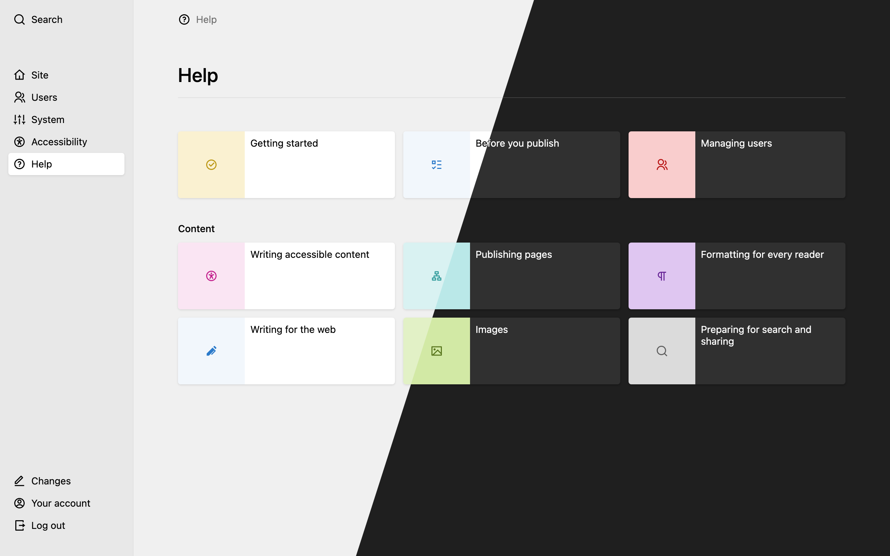
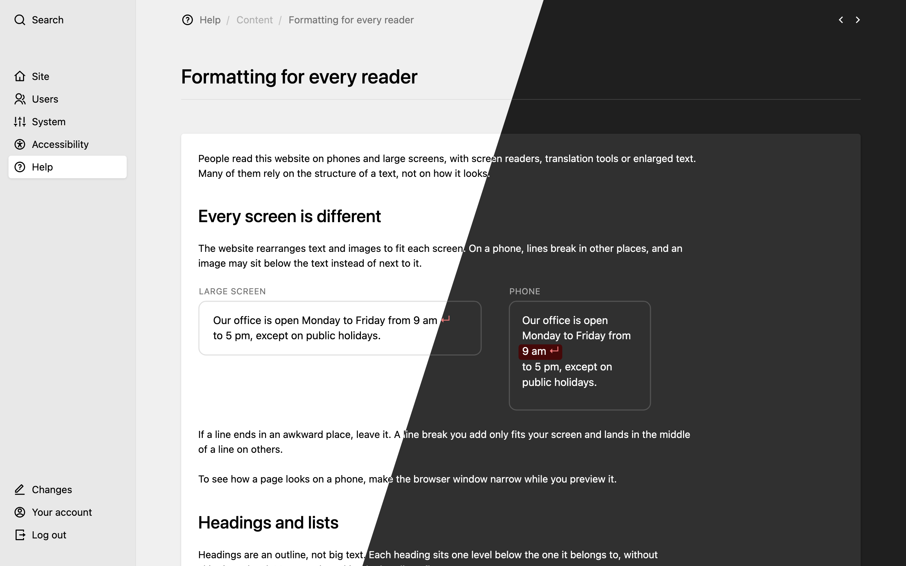
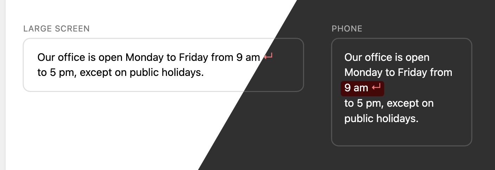
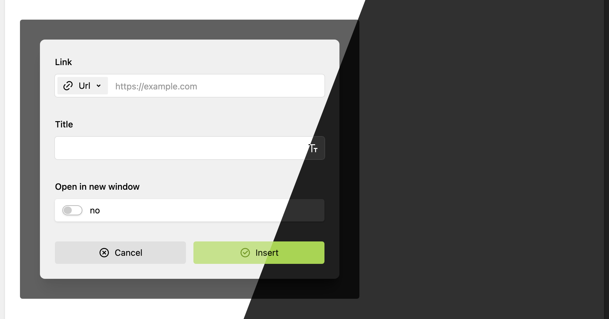
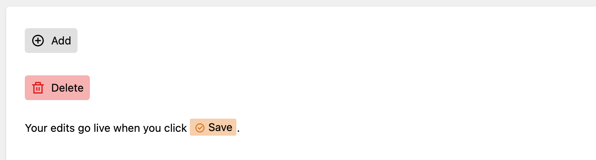
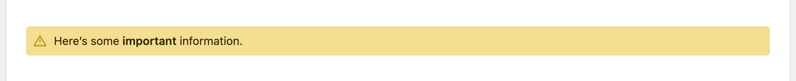
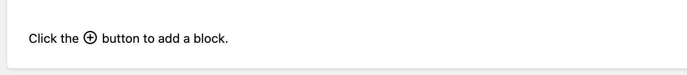

# Kirby Help View

A [Kirby](https://getkirby.com/) plugin that puts help for your clients into the Panel, right where they edit.

You write the articles as text files in your project, with KirbyText, categories and translations. They use the Panel's own buttons, boxes and icons, so the help looks like the screens it explains, in the light and the dark theme.




## Content Structure

Create a `site/help` folder with your articles:

```
site/help/
├── 1_getting-started/
│   ├── article.txt
│   ├── article.de.txt
│   └── article.ja.txt
├── 2_editing/
│   ├── category.txt
│   ├── 1_text/article.txt
│   └── 2_images/article.txt
└── 3_settings/article.txt
```

- Number prefixes (`1_`, `2_`) control the order
- Folders with `article.txt` become articles
- Folders without `article.txt` but with subfolders containing articles become categories. You can add an optional `category.txt` to overwrite the title.
- For multilanguage support, add language codes to filenames (e.g. `article.de.txt`). Depending on the user's Panel language, the appropriate article version will be shown.

Seems familiar, doesn't it? I tried to keep it close to Kirby's content structure while also keeping it out of the actual site content so you don't accidentally expose help articles on the public site.

### Example article

```yaml
# site/help/1_getting-started/article.txt

Title: Getting Started

----

Icon: book

----

Color: blue-600

----

Back: blue-200

----

Text:

## Welcome

Your help content here with **KirbyText** support.

(image: screenshot.png)
```

You can define an icon from Kirby's [icon set](https://lab.getkirby.com/public/lab/basics/icons/1_iconset) and colors from the Kirby [color variables](https://lab.getkirby.com/public/lab/basics/design/colors).

### Light and dark theme

SVG images follow the Panel theme when you colour them with its [colour variables](https://lab.getkirby.com/public/lab/basics/design/colors). Use `style` attributes, as a `<style>` element would restyle the whole Panel:

```svg
<rect style="fill: light-dark(var(--color-gray-200), var(--color-gray-800))" />
```



Screenshots need a dark copy with `-dark` in its name:

```
1_getting-started/
├── article.txt           (image: screenshot.png)
├── screenshot.png
└── screenshot-dark.png   shown when the Panel is dark
```



### Example category

```yaml
# site/help/2_editing/category.txt

Title: Editing Content
```

If you don't add a `category.txt`, the folder name will be used as the title (e.g. "2_editing" → "Editing"). If you're not having to deal with German Ümläuts (or other fancy characters) in your folder names, don't worry about it.

## Panel buttons, boxes and icons

To make your documentation match what clients actually see, you can drop `<k-button>`, `<k-box>` and `<k-icon>` straight into your articles. They render as the real Panel buttons, boxes and icons, reusing Kirby's own styles and icon set, so they always look like the real thing.

### Buttons

```html
<k-button icon="check" theme="positive">Save</k-button>
```

Because they render as Kirby's own buttons, the [Kirby Lab](https://lab.getkirby.com) is the live, visual reference for the icons, themes, variants and sizes you can use. All attributes are optional:

- `icon` – any icon name from the [icon set](https://lab.getkirby.com/public/lab/basics/icons/1_iconset)
- `theme` – a [theme](https://lab.getkirby.com/public/lab/components/buttons/2_themes) such as `positive` or `negative`
- `variant` – [`filled`](https://lab.getkirby.com/public/lab/components/buttons/1_variants) (default) or `dimmed`
- `size` – [`xs`, `sm`, `md`, `lg`](https://lab.getkirby.com/public/lab/components/buttons/3_sizes) (default `md`)
- `link` – turns the button into a link. Reference a file in the article's folder by name (e.g. `link="template.zip"`), just like the `(image:)` and `(file:)` tags. Relative URLs (e.g. `/panel/site`), `mailto:`, `tel:` and external links also work; external links open in a new tab.
- `download` – on a button that links to a file, saves it under its original filename instead of opening it in the browser
- `title` – accessible label for an icon-only button, e.g. `<k-button icon="add" title="Add"></k-button>` (matches Kirby's `k-button`; not needed when there's visible text)

A button on its own line renders at full size:

```html
<k-button icon="download" link="style-guide.pdf" download>Download the style guide</k-button>
```

Inside a sentence, a button shrinks to the text: it sits on the baseline, keeps the line height and never breaks between its icon and label. That makes it the way to name a Panel button in running text:

```html
Your edits go live when you click <k-button icon="check" theme="notice">Save</k-button>.
```

<picture>
  <source media="(prefers-color-scheme: dark)" srcset=".github/images/buttons-dark.png">
  
</picture>

### Boxes

Boxes look like Kirby's info field and are handy for tips, warnings and other callouts. Their content is KirbyText, so formatting, links, images and buttons work inside.

```html
<k-box icon="alert" theme="warning">
  Here's some **important** information.
</k-box>
```

<picture>
  <source media="(prefers-color-scheme: dark)" srcset=".github/images/box-dark.png">
  
</picture>

Both attributes are optional:

- `icon` – any icon name from the [icon set](https://lab.getkirby.com/public/lab/basics/icons/1_iconset)
- `theme` – a box [theme](https://lab.getkirby.com/public/lab/components/boxes/1_themes) like `info`, `positive`, `negative`, `notice` or `warning`. Without a theme the box has no background, just like Kirby's `k-box`.

Put boxes on their own lines with an empty line before and after. Boxes can't be nested. Like Kirby's info field, they are made for a sentence or two: longer content with headings or lists is better placed outside the box.

### Icons

Icons are inline and decorative by default (`aria-hidden`). When an icon carries meaning, add `alt` so screen readers announce it:

```html
Click the <k-icon name="add" alt="Add" /> button to add a block.
```

<picture>
  <source media="(prefers-color-scheme: dark)" srcset=".github/images/icon-dark.png">
  
</picture>

An icon followed by a word or a bold label never ends up alone at the end of a line: the two always wrap together.

Use any name from the [icon set](https://lab.getkirby.com/public/lab/basics/icons/1_iconset).

## Options

```php
// site/config/config.php
return [
	'medienbaecker.help-view' => [
		'root' => '/path/to/custom/help/folder'
	]
];
```

## Notes

- The help menu item only appears if the `site/help` folder exists.
- Help articles are trusted content (like your templates) – any HTML in them is rendered as-is.

## Requirements

Kirby 6. For Kirby 5, use version 1.

## Installation

### Composer

```
composer require medienbaecker/kirby-help-view
```

### Manual

Download and copy this repository to `site/plugins/kirby-help-view`.

## Credits

[kirby-helpsection](https://github.com/amteich/kirby-helpsection) by amteich was the original inspiration for this plugin. I've been using it for years and my clients loved it. Unfortunately it has not been updated since 2021 and is not compatible with Kirby 5, so I created this new version from scratch, trying to stick to core components as much as possible.
